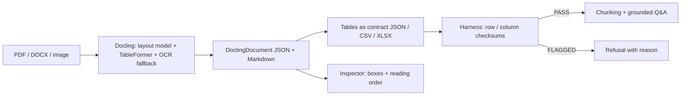

# Layout-Aware Document Intelligence with IBM Docling

Project 20 (ISG Tunis, AI Engineering & Software Architecture). A pipeline that turns complex
PDF / DOCX / scanned documents into **verified tables**, lets you inspect the layout boxes, and
answers questions **only** from tables that passed deterministic checksum checks.



## Folder map

| Folder / file | Role |
|---|---|
| `engine/` | `convert.py` Docling pipeline + retry cascade (fast → accurate → OCR); `contract.py` number cleaning; `boxes.py` layout boxes and reading order; `export.py` CSV / JSON / XLSX |
| `harness/` | checksum validator (Pydantic v2): row sums, column sums, empty cells, ragged rows |
| `inspector/` | Streamlit bounding-box inspector (`app.py`, `overlay.py`) |
| `api/`, `qa/` | FastAPI service, chunking (HybridChunker, Markdown fallback), grounded Q&A with refusal |
| `automation/` | watch-folder: file dropped in `inbox/` → API → verdict → answer or refusal |
| `baseline/` | pdfplumber baseline and comparison report (for the comparison matrix) |
| `samples/`, `fixtures/` | 4 test PDFs and 5 hand-written tables |
| `demo/` | **hand-written** test data for the API and Q&A tests (not Docling output) |
| `tests/` | pytest suite |

## Install (Windows)

Needs Python 3.10+ (3.12 recommended). Docling downloads about 5 GB of models on the first conversion.

```powershell
setup.bat full     # real Docling  (or: setup.bat   for the light install without Docling)
```

Manual: `py -m venv .venv`, `.venv\Scripts\Activate.ps1` (PowerShell, not `activate.bat`),
`pip install -r requirements.txt`.

## Run

| Goal | Command |
|---|---|
| Tests | `run_tests.bat` or `python -m pytest -q` |
| Convert documents | `python -m engine.convert samples --out output` (options: `--accurate`, `--ocr`, `--no-fallback`) |
| Validate tables | `python -m harness.validate output` |
| Baseline + comparison | `run_all.bat` (engine → harness → pdfplumber → harness → report) |
| Inspector | `run_inspector.bat` (after a conversion; or upload a PDF in the sidebar) |
| API | `run_api.bat` (real output) or `run_api.bat demo` (no Docling); Swagger at http://127.0.0.1:8000/docs |
| Watch-folder demo | `run_api.bat`, then `run_watch.bat "What is the total?"`, then copy a file into `automation\inbox\` |

Python API:

```python
from docling.datamodel.pipeline_options import PdfPipelineOptions
from docling.document_converter import DocumentConverter, PdfFormatOption
from docling.datamodel.base_models import InputFormat

opts = PdfPipelineOptions(); opts.do_table_structure = True
conv = DocumentConverter(format_options={InputFormat.PDF: PdfFormatOption(pipeline_options=opts)})
doc = conv.convert("report.pdf").document          # DoclingDocument
df = doc.tables[0].export_to_dataframe(doc=doc)     # pandas DataFrame
```

## Behaviour

| Situation | What happens |
|---|---|
| Unreadable file (corrupt, protected) or export error | file marked `failed`, batch continues, exit code 2 |
| PDF with 0 tables | retries fast → accurate → OCR + accurate; if still 0: `no_tables` + warning |
| Numbers like `1 234,56`, `1.234,56`, `(120)`, `$40` | converted to numbers; `12%` and `5 TND` stay text; `1,500` = 1500 |
| Merged cells | flattened to rows/columns (multi-level headers joined) |
| Table fails a checksum | `FLAGGED`; Q&A refuses and returns the reason |

`sample_wrong_total_long_title.pdf` is kept on purpose: it is a PDF where Docling finds 0 tables,
used to show the failure path. Docling-dependent paths (real conversion, HybridChunker reload,
`--vlm`) need a machine with Docling installed; the test suite uses fakes for them
(2 tests are skipped without Docling).

## API endpoints

| Endpoint | Purpose |
|---|---|
| `POST /convert` | upload a file (or send a server-side `path`) |
| `POST /convert/path` | JSON `{"path": "..."}` (used by the watch-folder) |
| `GET /tables/{id}` | one table with its verdict: `{table, verdict, usable}` |
| `POST /ask` | `{"question", "doc_id"}` → grounded answer with citations, or `refused: true` |
| `GET /health`, `/documents`, `/tables`, `POST /validate`, `POST /reload` | status and maintenance |

More detail: `api/README.md`, `qa/README.md`, `harness/README.md`, `automation/README.md`.
Reference: https://github.com/docling-project/docling
